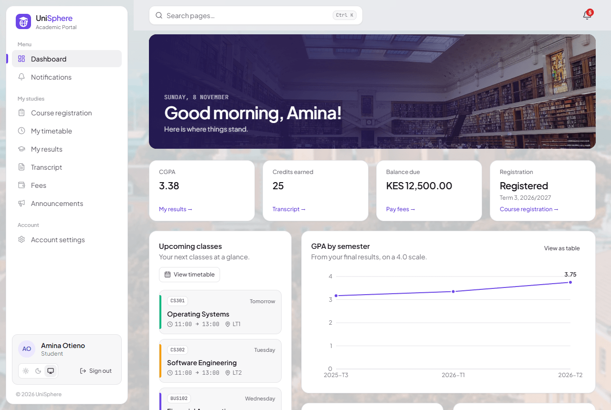
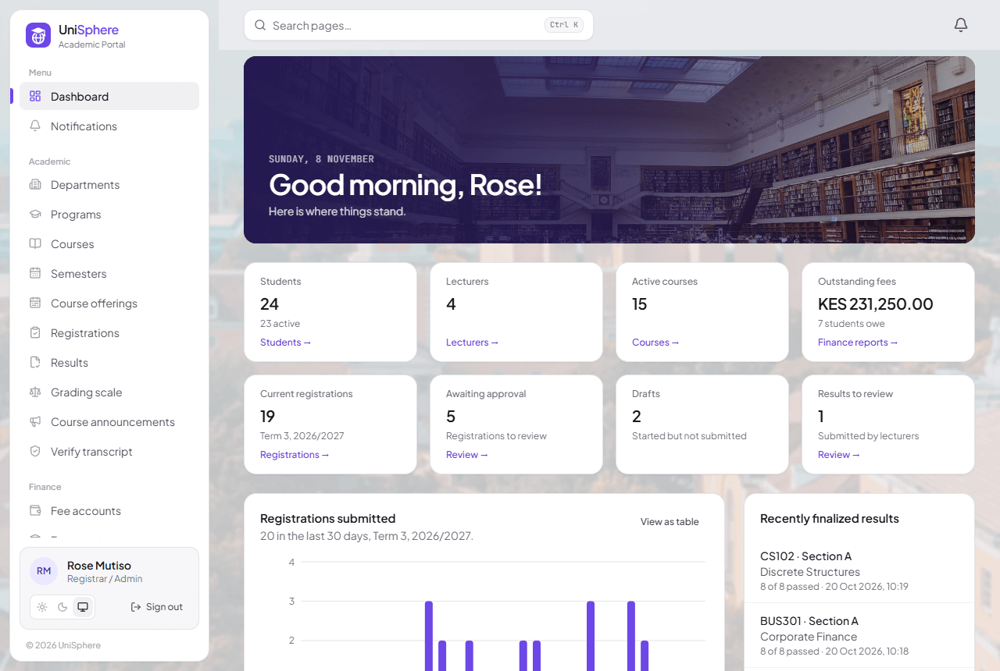
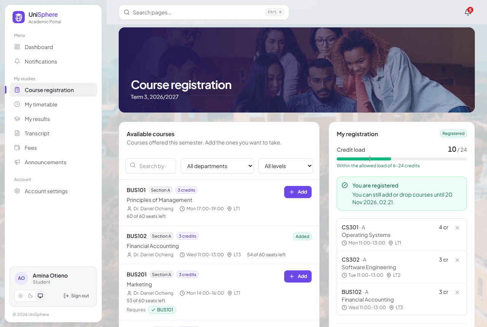
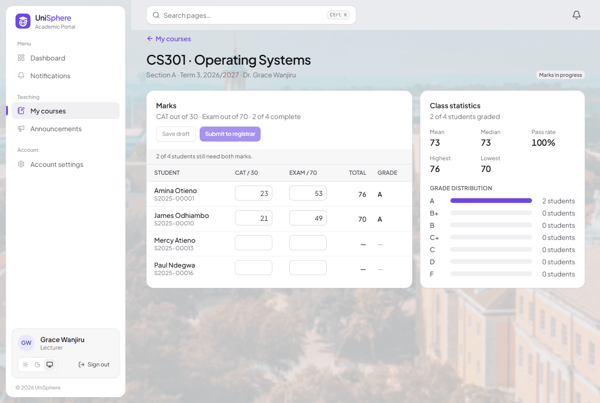
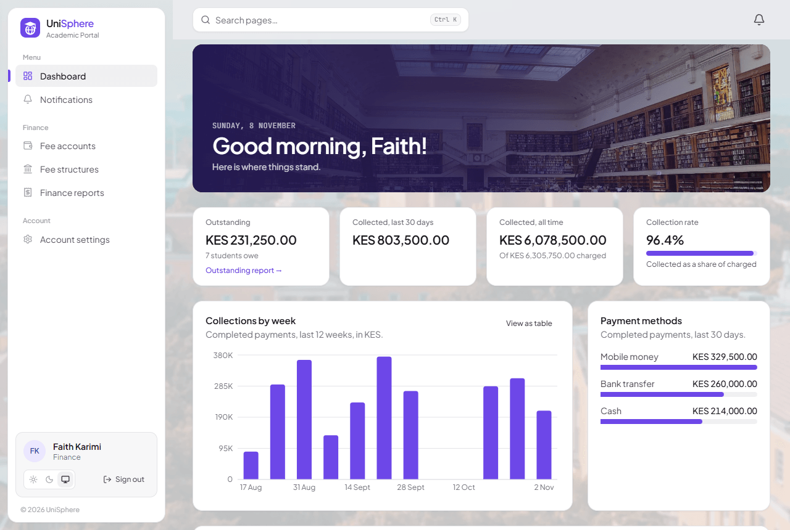
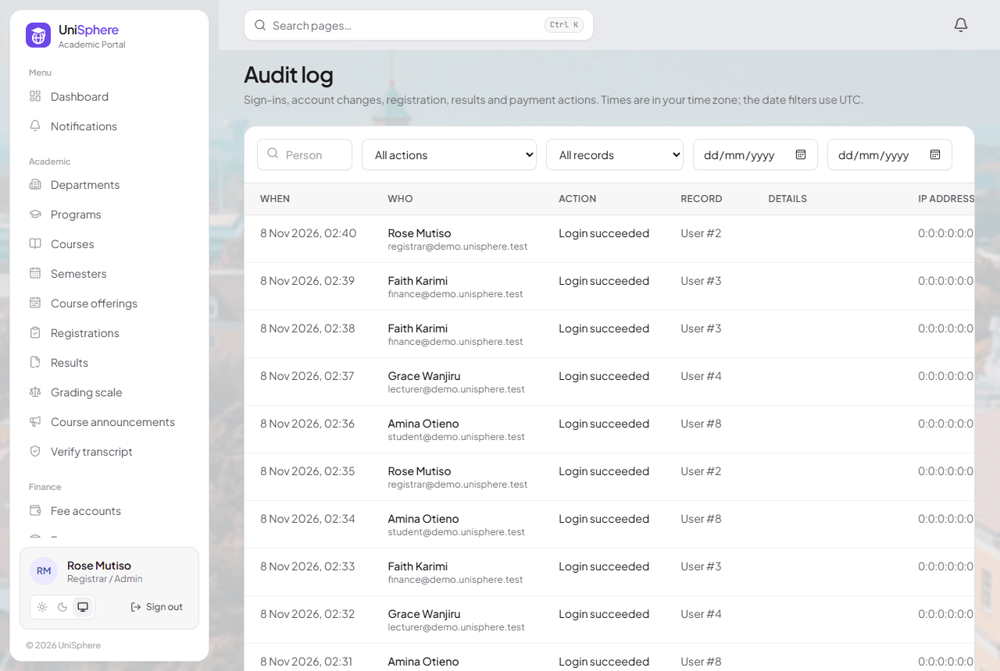
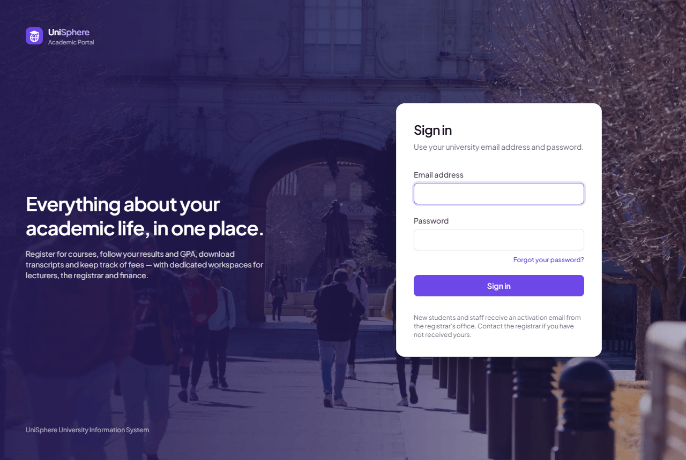
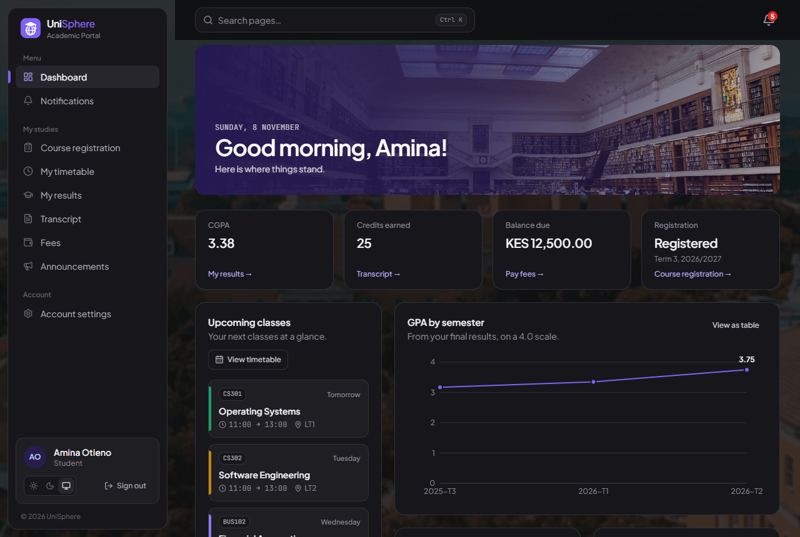
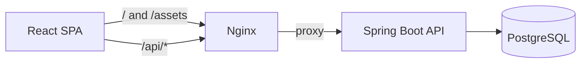

# UniSphere — University Student Management & Academic Portal

[](https://github.com/YusufRashi/unisphere-portal/actions/workflows/ci.yml)
[](https://github.com/YusufRashi/unisphere-portal/releases)


[](LICENSE)

A full-stack university information system: course registration, results and GPA, transcripts, fees and
notifications, with separate workspaces for students, lecturers, the registrar and finance.

**Stack:** Java 25 LTS · Spring Boot 4.1 · Spring Security (JWT + rotating refresh tokens) · Spring Data JPA ·
PostgreSQL 16 · Flyway · React 19 · TypeScript · Vite · Tailwind CSS 4 · TanStack Query · Docker · GitHub Actions

> **Status: all nine roadmap phases are complete.** See the [roadmap](docs/05-roadmap.md) for what each one delivers.
>
| Student dashboard | Registrar dashboard |
|---|---|
|  |  |
| **Course registration** | **Marks entry** |
|  |  |
| **Finance dashboard** | **Audit log** |
|  |  |
| **Sign in** | **Dark mode** |
|  |  |

---

## Contents

1. [Features](#features)
2. [Architecture](#architecture)
3. [Prerequisites](#prerequisites)
4. [Quick start with Docker](#quick-start-with-docker)
   - [Try it with demo data](#try-it-with-demo-data)
5. [Environment variables](#environment-variables)
6. [Running locally (without Docker for the app)](#running-locally)
7. [Running tests](#running-tests)
8. [Building for production](#building-for-production)
9. [Deployment](#deployment)
10. [API documentation](#api-documentation)
11. [Project structure](#project-structure)
12. [Security notes](#security-notes)

---

## Features

| Area | Feature | Status |
|------|---------|--------|
| Identity | Email/password login, BCrypt (cost 12) | ✅ |
| | 15-min JWT access token in memory + 7-day rotating refresh token in `HttpOnly; SameSite=Strict` cookie | ✅ |
| | Refresh-token reuse detection (revokes the whole token family) | ✅ |
| | Instant revocation of access tokens on deactivation / password change | ✅ |
| | Account lockout (5 attempts / 15 min) and per-IP rate limiting on auth endpoints | ✅ |
| | Account activation & password reset with single-use, hashed, expiring tokens | ✅ |
| | Role-based access control enforced on the server *and* reflected in the UI | ✅ |
| Platform | RFC 9457 Problem Details for every error, with request IDs | ✅ |
| | Audit log of security-relevant actions, with a viewer filtered by person, action, record and date | ✅ |
| | One-switch demo university for trying the system (never touches a database with data in it) | ✅ |
| | Production Compose stack with automatic TLS, release workflow publishing images to GHCR, Postman collection | ✅ |
| | Admin user directory: search, filter, sort, paginate, deactivate (with confirmation) | ✅ |
| | Docker Compose stack, least-privilege DB role, CI pipeline | ✅ |
| Academic | Departments, programs and courses with prerequisite **cycle detection** | ✅ |
| | Semesters with registration windows and a single current semester | ✅ |
| | Course offerings with weekly timetable and **venue / lecturer clash detection** | ✅ |
| People | Admin-created student, lecturer and staff accounts with activation links and generated student/staff numbers | ✅ |
| Registration | Course catalogue with per-course eligibility (prerequisites, seats, clashes) and reasons | ✅ |
| | Draft → submit → approve/return workflow with credit limits, deadlines and add/drop | ✅ |
| | **Race-free seat reservation** (guarded atomic update; tested with concurrent students) | ✅ |
| | Weekly student timetable (grid on desktop, agenda on phones) | ✅ |
| Results | Lecturer marks sheet (draft → submit), registrar finalize/return, grades fixed at finalization | ✅ |
| | Grading scale as data (validated: starts at 0, no gaps or overlaps, passes above fails) | ✅ |
| | Semester GPA and CGPA in **one tested `GpaCalculator`** (credit-weighted, latest attempt of a repeated course, half-up to 2 dp) | ✅ |
| | Class statistics; finalized passes satisfy registration prerequisites | ✅ |
| Transcripts | Unofficial transcript: print view and PDF, watermarked with generation time and reference on every page | ✅ |
| | Content-derived **verification reference** the registrar can check (genuine / superseded / never issued) | ✅ |
| Finance | Fee structures and semester billing, ledger with voids and reversals, office payments, repeat-safe online payments through a simulated gateway, outstanding and payment reports with CSV | ✅ |
| Engagement | In-app notifications for registration, results and fees (sent after commit, never duplicated), bell with unread badge and inbox | ✅ |
| | **Live** unread badge: the server pushes changes the moment they happen (Server-Sent Events), with slow polling as a fallback | ✅ |
| | Course announcements from lecturers, and from the registrar to any course | ✅ |
| | Old notifications cleaned up automatically after a retention period (180 days by default) | ✅ |
| Interface | Light and dark themes (following the system or the user's choice; printing is always light), page search with Ctrl/⌘ K | ✅ |
| | Scheduled reminders: registration deadline for students who have not submitted, outstanding fee balances | ✅ |
| | Dashboards for each role: student standing and GPA trend, lecturer marks progress, registrar overview and registration activity, finance collections; every chart also reads as a table | ✅ |

Full requirements and user stories: [docs/01-requirements.md](docs/01-requirements.md).

## Architecture



The SPA and API share one origin through Nginx (and through the Vite proxy in development), so there is
no CORS in normal operation and `SameSite=Strict` cookies just work. Details, decisions and diagrams:

- [System architecture](docs/02-architecture.md)
- [Database design & ERD](docs/03-database.md)
- [REST API specification](docs/04-api.md)
- [Development roadmap](docs/05-roadmap.md)

## Prerequisites

| Tool | Version | Needed for |
|------|---------|-----------|
| Docker Desktop / Docker Engine + Compose v2 | 24+ | Everything (simplest path) |
| JDK | 25 LTS | Running/testing the backend outside Docker |
| Node.js | 22+ (24 recommended) | Running/testing the frontend outside Docker |
| OpenSSL (or any random generator) | — | Generating secrets |

Maven is **not** required: the backend ships with the Maven Wrapper (`./mvnw`).

## Quick start with Docker

```bash
git clone <your-fork-url> unisphere && cd unisphere
cp .env.example .env
```

Edit `.env` and set at least:

```bash
POSTGRES_SUPERUSER_PASSWORD=<random>          # openssl rand -hex 24
DB_PASSWORD=<random>                          # openssl rand -hex 24
JWT_SECRET=<random base64, ≥ 32 bytes>        # openssl rand -base64 48
BOOTSTRAP_ADMIN_PASSWORD=<10+ chars, letter + digit, must not contain "registrar">
```

Then:

```bash
docker compose up --build
```

| URL | What |
|-----|------|
| http://localhost:3000 | Web app — sign in with `BOOTSTRAP_ADMIN_EMAIL` / `BOOTSTRAP_ADMIN_PASSWORD` |
| http://localhost:8080/swagger-ui.html | Interactive API docs |
| http://localhost:8080/actuator/health | Health check |

Stop with `docker compose down` (add `-v` to also delete the database volume).

### Try it with demo data

To explore the system with a populated university instead of an empty one, add this to `.env` **before the first
start** (the loader only runs on a database with no academic data; to reset an existing one, `docker compose down -v`):

```bash
SPRING_PROFILES_ACTIVE=demo
DEMO_PASSWORD=<10+ chars, letter + digit>     # there is no default; the API will not start without it
```

You get 24 students with three finished terms of results and fees, plus a term in progress with work left to do.
Dates are relative to today, so the dashboards always look current. Sign in with `DEMO_PASSWORD` as:

| Email | Role | Try |
|-------|------|-----|
| `student@demo.unisphere.test` | Student | Pay the fee balance, see a prerequisite block in course registration, download the transcript |
| `lecturer@demo.unisphere.test` | Lecturer | Submit CS302, finish marking CS301, post an announcement |
| `registrar@demo.unisphere.test` | Registrar | Approve registrations, finalize BUS201, browse the audit log |
| `finance@demo.unisphere.test` | Finance | Record or reverse a payment, export the outstanding report |

Never enable this profile in production.

### Database setup

There is nothing to run by hand:

1. On first start the Postgres container runs [`docker/postgres/init/01-create-app-role.sh`](docker/postgres/init/01-create-app-role.sh),
   which creates the application role (`DB_USERNAME`) **without** superuser, create-database or
   create-role rights, and a `unisphere` schema owned by that role.
2. When the API starts, **Flyway** applies the versioned migrations in
   [`backend/src/main/resources/db/migration`](backend/src/main/resources/db/migration).
   Hibernate only *validates* the schema (`ddl-auto=validate`).
3. If no administrator exists, the API creates one from `BOOTSTRAP_ADMIN_*`. Remove those variables after
   your first login.

## Environment variables

All configuration comes from environment variables; nothing secret is committed. `.env.example` lists
every variable with a description.

| Variable | Required | Description |
|----------|----------|-------------|
| `DB_URL` | no | JDBC URL (default `jdbc:postgresql://localhost:5432/unisphere`) |
| `DB_USERNAME` / `DB_PASSWORD` | **yes** | Application database role |
| `POSTGRES_SUPERUSER_PASSWORD` | Docker only | Superuser for the DB container's init script |
| `JWT_SECRET` | **yes** | Base64 HMAC key, ≥ 32 bytes. The API refuses to start otherwise |
| `JWT_ACCESS_TOKEN_TTL` / `REFRESH_TOKEN_TTL` | no | Defaults `15m` / `7d` |
| `COOKIE_SECURE` | no | `true` (default) in production; `false` only for plain-HTTP local dev |
| `CORS_ALLOWED_ORIGINS` | no | Only needed if SPA and API are on different origins |
| `APP_BASE_URL` | no | Public web-app URL used in activation / reset links |
| `UNIVERSITY_NAME` | no | Name printed on transcripts (default `UniSphere University`) |
| `FEE_CURRENCY` | no | ISO 4217 currency for fee accounts (default `KES`) |
| `NOTIFICATION_REMINDER_CRON` | no | When reminders are sent and old notifications cleaned up (Spring cron, UTC; default `0 0 6 * * *`, `-` turns both off) |
| `NOTIFICATION_RETENTION` | no | How long notifications are kept before the daily clean-up deletes them (default `180d`) |
| `AUTH_RATE_LIMIT_PER_MINUTE` | no | Per-IP limit on login, activation and password-reset requests (default 20; token refresh is not limited) |
| `BOOTSTRAP_ADMIN_EMAIL` / `BOOTSTRAP_ADMIN_PASSWORD` | first run | Creates the first admin if none exists |
| `MAIL_HOST` / `MAIL_PORT` | production | SMTP server for activation and password-reset emails (port default `587`). Empty: nothing is sent. See [Email](#email) |
| `MAIL_USERNAME` / `MAIL_PASSWORD` | if the server needs them | SMTP credentials |
| `MAIL_SECURITY` | no | `STARTTLS` (default), `TLS`, or `NONE` for a local test server |
| `MAIL_FROM` | with `MAIL_HOST` | Sender, e.g. `UniSphere <no-reply@university.edu>`. The API refuses to start without a valid one |
| `MAIL_LOG_LINKS` | no | `true` prints activation/reset links to the log while `MAIL_HOST` is empty (development only) |
| `API_DOCS_ENABLED` | no | Swagger UI / OpenAPI JSON (default `true`; set `false` in production) |
| `SPRING_PROFILES_ACTIVE` / `DEMO_PASSWORD` | demo only | `demo` loads the [demo university](#try-it-with-demo-data) into an empty database, with this password on every account |
| `TRUSTED_PROXY_CIDR` | behind a proxy | Web container: the proxy allowed to report the client's address and scheme (default: none) |

## Running locally

Run PostgreSQL in Docker and the app with hot reload on your machine:

```bash
docker compose up -d db                      # database only

# Terminal 1 — API on :8080 (reads ../.env automatically)
cd backend
./mvnw spring-boot:run                       # Windows: mvnw.cmd spring-boot:run

# Terminal 2 — web app on :5173 (proxies /api to :8080)
cd frontend
npm install
npm run dev
```

Open http://localhost:5173. For this setup set `APP_BASE_URL=http://localhost:5173` in `.env` so emailed
links point at the dev server.

> **No JDK installed?** You can build and test the backend in a container instead:
> `docker run --rm -v "$PWD/backend:/app" -w /app maven:3.9-eclipse-temurin-25 mvn verify`
> (integration tests additionally need `-v /var/run/docker.sock:/var/run/docker.sock -e TESTCONTAINERS_HOST_OVERRIDE=host.docker.internal`).

## Running tests

### Backend

```bash
cd backend
./mvnw test       # unit tests (fast, no Docker needed)
./mvnw verify     # unit + integration tests (*IT) against real PostgreSQL via Testcontainers — needs Docker
```

| Suite | What it covers |
|-------|----------------|
| `AuthServiceTest` | Login, lockout & expiry, deactivated/pending accounts, refresh rotation, reuse detection & grace period, reset, activation |
| `PasswordPolicyTest`, `FixedWindowRateLimiterTest`, `ActiveSessionValidatorTest`, `PageableFactoryTest` | Security and paging building blocks |
| `AuthFlowIT` | Full HTTP flows: cookies & headers, Problem Details shape, lockout, rotation + theft detection, CSRF header, logout, activation, reset, change password, security headers |
| `UserAdminIT` | RBAC (401 vs 403 for every non-admin role), search/filter/sort/paginate, LIKE-wildcard escaping, instant revocation on deactivation |
| `AuthRateLimitIT` | 429 + `Retry-After` on login; token refresh is never throttled (regression) |
| `PrerequisiteGraphTest`, `TimetableRulesTest`, `SemesterTest` | Cycle detection, timetable overlaps and clashes, semester date rules and status |
| `AcademicStructureIT` | Department/program/course CRUD, uniqueness, safe delete, field errors, prerequisite cycles, catalogue search, read-only access for students |
| `SemesterAndOfferingIT` | Semester validation, single current semester, registration flag + window, offering sections, weights, venue and lecturer clashes |
| `RegistrationRulesTest` | Window and add/drop deadline, duplicate course in any section, prerequisites, seats, credit limits, timetable clashes |
| `RegistrationFlowIT` | Draft → submit → timetable, every rule over HTTP, closed registration, **two students racing for the last seat**, approval with return and resubmission, add/drop moving seats until the deadline, ownership, suspended students |
| `GpaCalculatorTest`, `GradingRulesTest`, `ResultStatisticsTest` | GPA weighting and half-up rounding, repeated courses, band boundaries, mark limits, scale validation, mean/median/pass rate |
| `ResultsFlowIT` | Marks draft → incomplete submit rejected → submit → return → resubmit → finalize, student GPA/CGPA, grades unchanged by later scale edits, lecturer ownership and role boundaries, weight and class-list freezes |
| `TranscriptFingerprintTest`, `TranscriptPdfRendererTest` | Stable, content-derived references; PDF content, and watermark + timestamp + reference on every page of a multi-page transcript |
| `TranscriptIT` | JSON and PDF for the student, headers, re-issue stability, verification (current vs superseded), registrar access, role boundaries, empty record |
| `LedgerTest`, `SimulatedPaymentGatewayTest`, `CsvWriterTest` | Balance = active charges − completed payments with exact decimals, credit, online payment limits; deliberate declines; CSV quoting, BOM and formula neutralising |
| `FinanceFlowIT` | Fee structures → idempotent billing → office payment, duplicate reference, void and reversal keeping the ledger balanced; online payments repeat-safe by idempotency key, declined and over-balance payments; every role's access |
| `AccountProvisioningIT` | Student creation → activation → sign-in, unique numbers and emails, resend activation, record updates, staff role limits, RBAC |

### Frontend

```bash
cd frontend
npm test            # Vitest + Testing Library
npm run typecheck
npm run lint
```

Covers login form validation and redirects (including open-redirect protection), route guards for every
role, password-rule feedback, the accessible confirmation dialog, role-based navigation, the searchable
select (keyboard and async search), offering timetable validation, server-error mapping onto form fields,
the departments screen (listing, safe delete with confirmation, validation and duplicate conflicts), the
registration screen (eligibility reasons, add, server rule violations, submit and drop confirmations),
the timetable layout and credit meter, and the fees screen (statement, online payment, a declined payment
retried with a new idempotency key, amounts above the balance blocked) with the money helpers.

### API testing collection

Import [`postman/UniSphere.postman_collection.json`](postman/UniSphere.postman_collection.json): every endpoint,
generated from the API's OpenAPI document. Set the `baseUrl`, `email` and `password` collection variables, then send
**Authentication → Sign in with email and password**; it stores the access token for every other request.

Swagger UI at `/swagger-ui.html` works too: call `POST /api/auth/login`, copy `accessToken`, and click **Authorize**.

## Building for production

```bash
# Backend: executable jar → backend/target/unisphere-api.jar
cd backend && ./mvnw -B package

# Frontend: static files → frontend/dist
cd frontend && npm ci && npm run build

# Or the production images (multi-stage, non-root API user)
docker build -t unisphere-api ./backend
docker build -t unisphere-web ./frontend
```

## Deployment

### On a single server

[`deploy/docker-compose.prod.yml`](deploy/docker-compose.prod.yml) runs Caddy (automatic TLS) → Nginx (SPA and `/api`
proxy) → API → PostgreSQL. Only Caddy is reachable from outside.

```bash
cp deploy/.env.prod.example deploy/.env.prod     # set DOMAIN, the secrets and IMAGE_PREFIX
docker compose --env-file deploy/.env.prod -f deploy/docker-compose.prod.yml up -d
# Add --build to build the images on the server instead of pulling them.
```

The domain's DNS must point at the server, with ports 80 and 443 open, so Caddy can obtain a certificate. For a managed
PostgreSQL, remove the `db` service and set `DB_URL`; create the application role with the same privileges as the
[init script](docker/postgres/init/01-create-app-role.sh) (no superuser).

### On another platform

The images are platform-neutral:

- **API container:** all required variables, the `MAIL_*` settings, `COOKIE_SECURE=true`, `API_DOCS_ENABLED=false`,
  `MAIL_LOG_LINKS=false`.
  Readiness probe: `/actuator/health/readiness`. Never publish its port: it trusts `X-Forwarded-*` headers.
- **Web container:** serves the SPA and proxies `/api` to the API (service name `backend`). Terminate TLS in front of it
  and set `TRUSTED_PROXY_CIDR` to your proxy's address range. Without it, every user appears to come from the proxy
  and they all share one sign-in rate limit.

### Releases

Every push runs [`ci.yml`](.github/workflows/ci.yml): backend tests with Testcontainers, frontend
type-check/lint/tests/build, and both Docker image builds. Pushing a version tag
(`git tag v1.0.0 && git push origin v1.0.0`) runs [`release.yml`](.github/workflows/release.yml), which repeats those
checks and publishes `ghcr.io/<owner>/unisphere-api` and `-web`, tagged `1.0.0`, `1.0` and `latest`.

### Email

New accounts are activated, and forgotten passwords reset, through links sent by email. Set `MAIL_HOST`, `MAIL_FROM` and,
if your provider needs them, `MAIL_USERNAME`/`MAIL_PASSWORD`. Any SMTP service works:

| Provider | `MAIL_HOST` | `MAIL_USERNAME` |
|----------|-------------|-----------------|
| Amazon SES | `email-smtp.<region>.amazonaws.com` | SMTP credentials from the SES console |
| SendGrid | `smtp.sendgrid.net` | `apikey` (the password is the API key) |
| Mailgun | `smtp.mailgun.org` | the domain's SMTP login |
| Microsoft 365 | `smtp.office365.com` | the mailbox address |

The sender's domain must be verified with the provider (SPF/DKIM), or messages land in spam.

Emails are plain text and go out only after the change that created the link is saved, on a background thread with
three attempts. A slow or unavailable mail server therefore never slows down or fails a request, and "forgot password"
answers the same way whether or not the address has an account. If sending fails, the log says so (without the link),
and the registrar can send a new activation link from the user's record. Encryption is required by default: with
`STARTTLS` the API refuses to send over an unencrypted connection.

Without `MAIL_HOST`, nothing is sent. That suits development, where `MAIL_LOG_LINKS=true` prints the links to the log
instead; never use that setting in production, because the links are secrets. The production Compose file refuses to
start without `MAIL_HOST`.

## API documentation

- Design contract: [docs/04-api.md](docs/04-api.md)
- Live OpenAPI: `GET /v3/api-docs`, Swagger UI at `/swagger-ui.html` (when `API_DOCS_ENABLED=true`)

Example error response (all errors share this shape):

```json
{
  "type": "https://unisphere.dev/problems/invalid-credentials",
  "title": "Invalid credentials",
  "status": 401,
  "detail": "Invalid email or password.",
  "instance": "/api/auth/login",
  "code": "INVALID_CREDENTIALS",
  "timestamp": "2026-10-04T09:17:45.420Z",
  "requestId": "37f56ea089549ce65ffd1916e8bc1d1f"
}
```

## Project structure

```
unisphere/
├── backend/                 Spring Boot API (package-by-feature: auth, user, audit, common, …)
│   └── src/main/resources/db/migration   Flyway migrations
├── frontend/                React + TypeScript SPA (app, api, auth, components, features, …)
│   └── nginx/               Production Nginx config + security headers
├── docker/postgres/init/    Least-privilege database role setup
├── deploy/                  Production Compose stack with Caddy
├── postman/                 API collection
├── docs/                    Requirements, architecture, ERD, API spec, roadmap, screenshots
├── .github/workflows/       CI and release
├── docker-compose.yml       Local full stack
└── .env.example             Configuration template (placeholders only)
```

## Security notes

- Passwords: BCrypt cost 12; policy enforced server-side (the UI mirrors it for instant feedback).
- Tokens: access token only in memory; refresh token `HttpOnly`, `SameSite=Strict`, path-scoped,
  stored as SHA-256 hash, rotated on every use, reuse revokes the family.
- CSRF: bearer-token API; the only cookie endpoints require `SameSite=Strict` **and** a custom header.
- Authorization: URL rules + `@PreAuthorize` on every controller; route guards in the UI are UX only.
- Input: Bean Validation on every request body; JPA parameter binding (no string-built SQL);
  sort fields whitelisted; LIKE wildcards escaped.
- Output: Problem Details without stack traces or framework messages; a strict CSP with no inline scripts or styles,
  `X-Frame-Options: DENY`, `nosniff`, `Referrer-Policy`, `Permissions-Policy`, cross-origin isolation headers, and HSTS
  over HTTPS.
- Proxying: forwarded client addresses and schemes are believed only from the configured proxy, so they cannot be
  spoofed to dodge rate limits; Actuator and Swagger are not reachable through the web container.
- Abuse: per-IP rate limit on auth endpoints + per-account lockout; generic login errors and
  always-`202` password reset requests prevent account enumeration.
- Operations: secrets only from the environment, with no default credentials; app DB role is not a superuser; the API
  container runs as non-root.

## License

[MIT](LICENSE)
