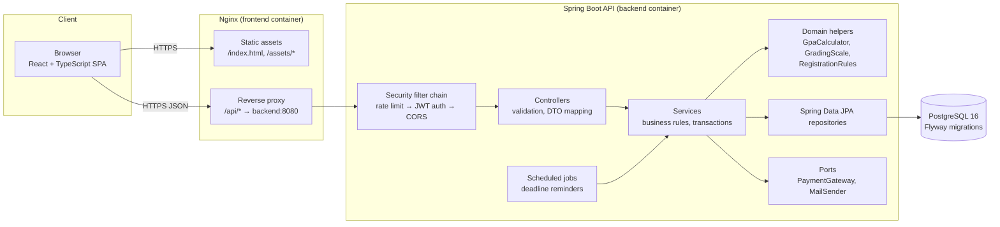

# UniSphere — System Architecture

## 1. Overview

UniSphere is a classic three-tier web application: a React single-page app, a
stateless Spring Boot REST API, and PostgreSQL. In production the SPA is
served by Nginx, which also reverse-proxies `/api` to the backend so that the
browser sees a single origin (no CORS in production, `SameSite=Strict` cookies
work naturally).



## 2. Key architectural decisions

| # | Decision | Rationale |
|---|----------|-----------|
| AD-1 | **Modular monolith, package-by-feature** | One deployable is right for the team size; feature packages (`registration`, `result`, `finance`…) keep boundaries clear and could be extracted later. |
| AD-2 | **Stateless JWT access token (15 min) + opaque rotating refresh token in HttpOnly cookie** | Access token held in memory on the client (not `localStorage`) limits XSS token theft; refresh cookie is `HttpOnly`, `SameSite=Strict`, path-scoped to `/api/auth`. Refresh tokens are hashed (SHA-256) in the DB and support revocation and reuse detection. |
| AD-3 | **CSRF**: Spring's CSRF filter disabled for the API, compensated by design | State-changing endpoints authenticate with a bearer header, which browsers never attach automatically. The only cookie-authenticated endpoints (`/api/auth/refresh`, `/api/auth/logout`) require `SameSite=Strict` *and* a custom `X-Requested-With` header, which cross-site forms cannot send without a CORS preflight. |
| AD-4 | **Flyway migrations, `ddl-auto=validate`** | Schema is versioned, reviewable SQL; Hibernate only verifies mappings. |
| AD-5 | **Business rules in services and small pure domain classes** | `GpaCalculator`, `GradingScale`, `RegistrationRules` have no Spring/JPA dependencies → fast, exhaustive unit tests. |
| AD-6 | **DTOs at the API boundary (Java records)** | Entities never leave the service layer; prevents over-posting and lazy-loading leaks. |
| AD-7 | **RFC 9457 Problem Details for all errors** | One error shape; includes a machine-readable `code` and field-level `errors` for validation. |
| AD-8 | **Ownership checks in services, role checks via `@PreAuthorize`** | Roles answer "may this kind of user call this?", ownership answers "may *this* user touch *this* record?". Both are server-side. |
| AD-9 | **Ledger-style finance** | Balances are derived from immutable charges and payments; corrections are reversals. Auditable and simple to reason about. |
| AD-10 | **Ports & adapters for external systems** | `PaymentGateway` (simulated impl) and `MailSender` (logging impl) isolate future integrations. |
| AD-11 | **Server state via TanStack Query; auth state in a React context** | Caching, refetch and loading/error states for free; no global Redux store needed. |
| AD-12 | **Same-origin in production via Nginx** | Removes CORS from production entirely; CORS is only configured for the Vite dev server origin. |

## 3. Request lifecycle

1. Request hits `RateLimitFilter` (auth endpoints only) → `JwtAuthenticationFilter`
   validates the bearer token signature, expiry, issuer, and loads authorities
   from claims.
2. `@PreAuthorize` on the controller method checks the role.
3. Controller validates the body with Bean Validation (`@Valid`) and calls a service.
4. Service runs inside `@Transactional`, applies ownership checks and business
   rules, writes audit entries for significant actions.
5. Exceptions propagate to `GlobalExceptionHandler`, which maps them to Problem
   Details without leaking internals.

## 4. Authentication flow

```mermaid
sequenceDiagram
    participant U as Browser (SPA)
    participant A as API /api/auth
    participant DB as PostgreSQL

    U->>A: POST /login {email, password}
    A->>DB: find user, verify BCrypt hash, check status/lock
    A->>DB: insert refresh_token (sha256 hash, family id, expiry)
    A-->>U: 200 {accessToken, user} + Set-Cookie: refresh=… (HttpOnly, SameSite=Strict, Path=/api/auth)
    Note over U: access token kept in memory only

    U->>A: GET /api/... Authorization: Bearer <access>
    A-->>U: 200

    Note over U: access token near expiry or 401
    U->>A: POST /refresh (cookie + X-Requested-With)
    A->>DB: find token by hash; if revoked → revoke whole family (reuse detected) → 401
    A->>DB: revoke old, insert new (same family)
    A-->>U: 200 {accessToken} + new cookie

    U->>A: POST /logout (cookie)
    A->>DB: revoke token
    A-->>U: 204 + expired cookie
```

## 5. Backend structure (package-by-feature)

```
backend/src/main/java/com/unisphere/
├── UniSphereApplication.java
├── common/
│   ├── config/          # Jackson, clock, OpenAPI, properties binding
│   ├── exception/       # ApiException hierarchy, GlobalExceptionHandler
│   ├── security/        # SecurityConfig, JWT service/filter, rate limiter, CurrentUser
│   ├── web/             # PageResponse, request-id filter
│   └── persistence/     # BaseEntity (id, timestamps, version)
├── auth/                # login, refresh, logout, activation, password reset
├── user/                # User, Role, account admin
├── audit/               # AuditLog entity, AuditService, admin viewer
├── academic/            # Department, Program, Course, prerequisites
├── semester/            # Semester, calendar rules
├── offering/            # CourseOffering, schedules
├── registration/        # Registration, items, RegistrationRules
├── result/              # Result, GradingScale, GpaCalculator, statistics
├── transcript/          # transcript assembly + PDF rendering
├── finance/             # FeeAccount, charges, payments, PaymentGateway port
├── notification/        # Notification, Announcement, scheduled reminders
└── dashboard/           # read-only aggregate queries per role
```

Each feature package follows the same internal shape:
`XController` → `XService` → `XRepository`, with `dto/` for request/response
records and the JPA entities alongside.

## 6. Frontend structure

```
frontend/src/
├── main.tsx, App.tsx
├── app/                 # router, providers (QueryClient, Auth), layouts
├── api/                 # axios instance, interceptors, typed endpoint functions
├── auth/                # AuthContext, ProtectedRoute, RoleGuard, login/activation pages
├── components/
│   ├── ui/              # Button, Input, Card, Badge, Dialog, Table, Spinner, EmptyState…
│   └── layout/          # Sidebar, Topbar, PageHeader
├── features/
│   ├── student/         # dashboard, catalogue, registration, results, transcript, fees
│   ├── lecturer/        # offerings, marks entry, stats, announcements
│   ├── admin/           # structure CRUD, semesters, offerings, users, approvals, audit
│   ├── finance/         # accounts, payments, reports
│   └── notifications/
├── hooks/               # shared hooks (useDebounce, usePagination…)
├── lib/                 # formatting (money, dates, GPA display), cn()
└── types/               # API types mirrored from backend DTOs
```

Rules:
- Components never call `axios` directly — they use hooks in `features/*/api.ts`
  built on TanStack Query.
- GPA, grades and balances are **displayed** by the frontend, never computed.
- Route guards are a UX convenience; the backend is the authority.

## 7. Repository layout

```
unisphere/
├── backend/             # Spring Boot (Maven)
├── frontend/            # React + Vite
├── docs/                # requirements, architecture, ERD, API, roadmap, screenshots
├── postman/             # API collection + environment
├── deploy/              # production compose, nginx config
├── .github/workflows/   # CI
├── docker-compose.yml   # local development stack
├── .env.example
├── LICENSE
└── README.md
```

## 8. Deployment strategy (summary — detailed in Phase 9)

- **Images:** multi-stage builds — `maven` → `eclipse-temurin:21-jre-alpine`
  for the API (non-root user); `node` → `nginx:alpine` for the SPA.
- **Target:** any container host. Reference deployment: a single VM (or
  Render / Railway / Fly.io) running `deploy/docker-compose.prod.yml` behind
  TLS, with managed PostgreSQL in production.
- **Config:** 12-factor; every secret via environment variables; JWT secret
  ≥ 256 bits; Postgres app user without superuser.
- **CI/CD:** GitHub Actions runs backend tests (with Testcontainers), frontend
  lint/test/build on every push and PR; tagged releases build and push images
  to GHCR.
