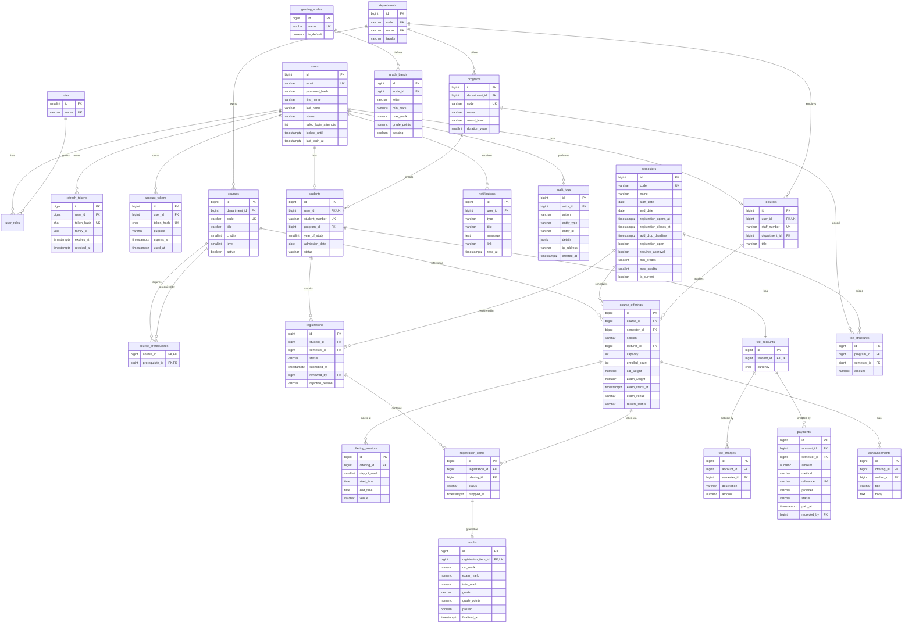

# UniSphere — Database Design

PostgreSQL 16. All tables use `BIGINT GENERATED ALWAYS AS IDENTITY` primary keys
(except pure join tables and the tiny `roles` lookup), `TIMESTAMPTZ` timestamps
in UTC, and a `version` column for optimistic locking on rows that are edited
concurrently. Money is `NUMERIC(12,2)`. Enumerations are `VARCHAR` with `CHECK`
constraints (portable, readable, and easy to extend through a migration).

## 1. Entity-relationship diagram

## 2. Relationship explanation

**Identity.** `users` holds credentials and account state for *every* person.
Role membership is many-to-many through `user_roles`, so one person can be both
`LECTURER` and `ADMIN`. Role-specific data lives in 1:1 profile tables
(`students`, `lecturers`) keyed by a unique `user_id` — this avoids a wide
`users` table full of nullable columns. `refresh_tokens` and `account_tokens`
(activation & password-reset) store only SHA-256 hashes of the token values.

**Academic structure.** A `department` owns `programs` (what a student enrolls
in) and `courses` (what is taught). `course_prerequisites` is a self-referencing
many-to-many on `courses`; a `CHECK (course_id <> prerequisite_id)` blocks
trivial self-loops and the service rejects longer cycles with a graph search.

**Calendar & offerings.** A `course` is abstract ("CS201 Data Structures"); a
`course_offering` is that course taught in one `semester` by one `lecturer`
with a capacity — unique on `(course_id, semester_id, section)`.
`offering_sessions` holds the weekly meeting slots used to build timetables.
`enrolled_count` is a denormalised counter updated with a guarded atomic
statement (`UPDATE … SET enrolled_count = enrolled_count + 1 WHERE id = ? AND
enrolled_count < capacity`) so two students can never take the last seat; a
`CHECK (enrolled_count BETWEEN 0 AND capacity)` is the final safety net.

**Registration.** One `registration` per student per semester (unique
`(student_id, semester_id)`) is the "registration form"; its
`registration_items` are the chosen offerings. Items are soft-dropped
(`status = 'DROPPED'`) rather than deleted, preserving history. A partial unique
index on `(registration_id, offering_id) WHERE status = 'ACTIVE'` prevents
duplicates while allowing re-adding a dropped item. "Same course twice in one
semester" (e.g. two sections) is checked in the service.

**Results.** A `result` belongs to exactly one `registration_item` (unique FK),
which already identifies student, offering, course and semester — no
duplicated foreign keys that could disagree. The result lifecycle
(`DRAFT/SUBMITTED/FINALIZED`) lives on the *offering* (`results_status`)
because marks are submitted and finalized per class. On finalization, `grade`,
`grade_points` and `passed` are snapshotted from the active `grading_scale` so
later scale changes never alter historical records.

**Finance.** Each student has one `fee_account`. Its balance is *derived*:
`Σ fee_charges.amount − Σ payments.amount WHERE status = 'COMPLETED'`. Rows are
never updated or deleted for corrections; a reversed payment gets
`status = 'REVERSED'` and an audit entry. `payments.reference` is unique to make
double-recording impossible. `provider`/`provider_txn_id` let a real gateway be
plugged in later. No card or credential data has a column to live in.

**Notifications & audit.** `notifications` are per-user rows with `read_at`
(NULL = unread). `announcements` belong to an offering and fan out into
notifications for enrolled students. `audit_logs` is append-only; `details`
is `JSONB` for flexible before/after snapshots; `actor_id` is nullable for
system actions.

## 3. Indexes (beyond PK/UK)

| Table | Index | Serves |
|-------|-------|--------|
| users | `lower(email)` unique | case-insensitive login |
| refresh_tokens | `(user_id)`, `(family_id)` | revoke-all on logout/deactivation, reuse detection |
| students | `(program_id)` | admin filters |
| courses | `(department_id, level)` | catalogue filters |
| course_offerings | `(semester_id)`, `(lecturer_id)` | catalogue, lecturer views |
| registrations | `(semester_id, status)` | approval queue, dashboard counts |
| registration_items | `(offering_id) WHERE status='ACTIVE'` | class lists |
| payments | `(account_id, paid_at DESC)` | payment history |
| fee_charges | `(account_id)` | balance |
| notifications | `(user_id, created_at DESC)`, partial `(user_id) WHERE read_at IS NULL` | inbox, unread badge |
| audit_logs | `(entity_type, entity_id)`, `(actor_id)`, `(created_at DESC)` | audit viewer filters |
| semesters | partial unique `(is_current) WHERE is_current` | single current semester |

## 4. Migration plan

Migrations grow with the roadmap so every phase ships a working schema:

| Version | Phase | Contents |
|---------|-------|----------|
| V1 | 1 | roles, users, user_roles, refresh_tokens, account_tokens, audit_logs |
| V2 | 2 | departments, programs, courses, course_prerequisites, students, lecturers |
| V3 | 2 | semesters, course_offerings, offering_sessions |
| V4 | 3 | registrations, registration_items |
| V5 | 4 | grading_scales, grade_bands (+ default scale), results |
| V6 | 6 | fee_accounts, fee_structures, fee_charges, payments |
| V7 | 7 | notifications, announcements |

Demo data is **not** in migrations; it is loaded by a `demo` Spring profile
seeder so production databases never receive fake records.
